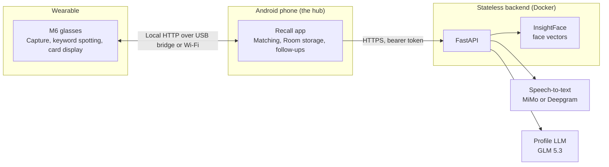

# Building Recall

**Setup, architecture, and development guide.**

Recall turns a conversation into a private profile. The next time you see that person, your glasses show their name, what you talked about, what you promised, and what to avoid bringing up.

Built at [Worn: Smart Glasses Hackathon](README.md), NYC, November 20 to 21, 2026, for the MicroLumin M6 glasses.


[Project write-up](README.md) · [User guide](docs/USER_GUIDE.md) · [API reference](docs/API.md)

> **Recall records people and processes their faces.** It is a research prototype. Get consent before you record anyone, and read [Privacy and responsible use](#privacy-and-responsible-use) before running it.

## How it works

1. **Meet someone.** Tap the glasses or say "Hello, nice to meet you." Recall takes a few photos, announces the recording out loud, and records the conversation.
2. **Build a profile.** When the conversation ends, the phone transfers the capture and has the backend extract a face vector, a speaker-labeled transcript, and a structured profile.
3. **Follow up.** The phone schedules follow-ups the conversation calls for and prepares a draft. You review it and send it yourself.
4. **Meet them again.** Look at them and tap. The glasses show who they are and what matters before you say hello.

```text
Recall                     ● Listening
--------------------------------------
Sam Rivera
ML engineer at Acme

Talk about: robotics side project
Follow up: send the RAG article
```

## Features

- **Hands-free capture** with offline keyword spotting on the glasses. Nothing is saved while it waits for the greeting.
- **Closed-set recognition.** Recall only matches people you have already saved, and it never looks anyone up by face.
- **Grounded profiles.** The server validates every model reply and rejects output that breaks the profile rules.
- **Conversation memory.** A new conversation merges into the person's existing profile.
- **Follow-up drafts.** Recall suggests timing and wording but never sends a message for you.
- **Glanceable display.** Cards fit a small green display, with more detail a swipe away.
- **Discreet "avoid" notes.** Sensitive topics are never read aloud automatically.
- **Local-first storage.** Profiles and face vectors stay on your phone. The backend keeps no database.

## Architecture



| Component | Stack | Responsibility |
| --- | --- | --- |
| [`glasses-app/`](glasses-app/) | Kotlin, Android Views, NanoHTTPD, Vosk | Capture photos and audio, listen for phrases, display cards |
| [`phone-app/`](phone-app/) | Kotlin, Jetpack Compose, Ktor, Room, WorkManager | Sync captures, match faces, store people, schedule follow-ups |
| [`backend/`](backend/) | Python 3.12, FastAPI, Pydantic, InsightFace, ffmpeg | Embed faces, transcribe audio, build and validate profiles |

## Getting started

### Prerequisites

| You need | For |
| --- | --- |
| [Docker Desktop](https://www.docker.com/products/docker-desktop/) | Running the backend |
| A [NanoGPT](https://nano-gpt.com/) API key | Profile generation and transcription |
| [cloudflared](https://developers.cloudflare.com/cloudflare-one/connections/connect-networks/downloads/) | Giving the phone an HTTPS route to the backend |
| [Android Studio](https://developer.android.com/studio) with API 37 and platform-tools | Building and installing both Android apps |
| Android 10 or later phone | Running the hub |
| MicroLumin M6 glasses with USB debugging on | Running the glasses app |
| [Git Bash](https://git-scm.com/downloads) on Windows | Running the USB bridge script |

The backend runs on its own, so you can try the API without any Android hardware.

### 1. Clone the repository

```bash
git clone https://github.com/DonYuen231/MicroLumin_Hackathon.git
cd MicroLumin_Hackathon
```

### 2. Start the backend

```bash
cd backend
cp .env.example .env
```

Edit `.env` and set at least:

```ini
APP_TOKEN=a-long-random-string
NANOGPT_API_KEY=your-nanogpt-key
```

Then build and start it. The first build downloads the face model, and the image is about 4.4 GB.

```bash
docker compose up -d --build
curl http://localhost:8000/healthz
```

You should see `{"ok":true}`.

### 3. Expose the backend to the phone

```bash
cloudflared tunnel --url http://localhost:8000
```

Copy the `https://<random>.trycloudflare.com` URL it prints. A quick tunnel gets a new URL each time it starts.

### 4. Install the phone app

Connect the phone with USB debugging on, then run this from the repository root:

```powershell
$env:JAVA_HOME = "C:\Program Files\Android\Android Studio\jbr"
Push-Location phone-app; .\gradlew.bat installDebug; Pop-Location
```

Open **Recall > Settings**, enter the **Backend URL**, **App token**, and your **Wearer name**, then tap **Test backend**.

### 5. Install the glasses app

Turn on Developer Mode using the manufacturer's instructions, then connect the glasses over USB.

```powershell
$adb = "$env:LOCALAPPDATA\Android\Sdk\platform-tools\adb.exe"
& $adb devices -l

Push-Location glasses-app; .\gradlew.bat assembleDebug; Pop-Location
& $adb -s <glasses> install -r -g glasses-app\app\build\outputs\apk\debug\app-debug.apk
```

For hands-free capture, download and unzip the [Vosk small English model](https://alphacephei.com/vosk/models/vosk-model-small-en-us-0.15.zip) (about 41 MB), then push it once:

```powershell
& $adb -s <glasses> push vosk-model-small-en-us-0.15 /sdcard/Android/data/app.recall.glasses/files/
& $adb -s <glasses> shell am start -n app.recall.glasses/.MainActivity
```

Without the model, Recall still works with tap and click controls.

### 6. Link the glasses and phone

USB is the reliable setup. Plug both devices into the computer, then run this in Git Bash and leave it open:

```bash
export GLASSES_MODEL=<model shown by adb devices -l>
sh scripts/usb-bridge.sh
```

The script finds the glasses from `GLASSES_MODEL` and a Samsung phone by model name. For another phone brand, change the `serial SM_` line in [`scripts/usb-bridge.sh`](scripts/usb-bridge.sh).

You're ready when the glasses show **● Listening** and **Phone connected**. The [user guide](docs/USER_GUIDE.md) covers daily use and troubleshooting.

## Configuration

Backend settings live in `backend/.env`. Never commit this file.

| Variable | Required | Default | Purpose |
| --- | --- | --- | --- |
| `APP_TOKEN` | Yes | None | Bearer token the phone sends. The server won't start without it |
| `NANOGPT_API_KEY` | Yes, unless both models are replaced | Empty | Key for profile generation and default transcription |
| `NANOGPT_BASE_URL` | No | `https://nano-gpt.com/api/subscription/v1` | OpenAI-compatible endpoint |
| `LLM_MODEL` | No | `z-ai/glm-5.3` | Profile model |
| `STT_PROVIDER` | No | `nanogpt` | `nanogpt` or `deepgram` |
| `STT_MODEL` | No | `xiaomi/mimo-v2.6-pro` | NanoGPT transcription model |
| `DEEPGRAM_API_KEY` | With Deepgram | Empty | Deepgram transcription key |
| `FACE_MODEL` | No | `buffalo_l` | InsightFace model pack |

## Development

Backend tests use mocked services and a fake face engine, so they need no API keys or Docker.

```bash
cd backend
uv sync
uv run python -m pytest
uv run ruff check .
uv run ruff format --check .
```

Android unit tests:

```powershell
Push-Location phone-app; .\gradlew.bat testDebugUnitTest; Pop-Location
Push-Location glasses-app; .\gradlew.bat testDebugUnitTest; Pop-Location
```

```text
.
├── backend/       FastAPI service, Dockerfile, tests, and fixtures
├── phone-app/     Android hub app
├── glasses-app/   Android app for the M6 glasses
├── scripts/       USB bridge and demo recording helpers
└── docs/          Write-up, user guide, and API reference
```

## Privacy and responsible use

Recall handles sensitive personal data, including face vectors, which some laws treat as biometric data.

- **Consent comes first.** Recording laws vary, and some US states require everyone's consent. The spoken notice is not consent, so ask before recording.
- **Biometric laws may apply.** Laws such as Illinois BIPA regulate face data. Don't use Recall on people who haven't agreed to it.
- **Data stays close.** People, profiles, and face vectors stay on the phone. The backend keeps no database and doesn't log images, audio, or transcripts.
- **Third parties still process data.** Audio and transcripts are sent to the configured speech and LLM providers. Review their terms before using real conversations.
- **Models can be wrong.** A profile can misattribute or miss a detail, so review it before relying on it.

## Known limitations

- Each capture supports one conversation partner.
- The wireless hotspot link was unreliable in testing, so USB is the supported setup.
- The face match threshold (0.45) was tuned on only a few faces.
- A nearby voice can trigger the greeting phrase, and loud rooms can cause missed or false triggers.
- "Since you met" updates are **simulated** from a fixture file.
- There is no iPhone app yet.
- InsightFace's pretrained models are for non-commercial research, so a commercial release would need a licensed model.

## Roadmap

- [ ] Consent flow that works for both people
- [ ] Reliable wireless link between the glasses and phone
- [ ] Group conversations
- [ ] Real profile refresh from links a person chose to share
- [ ] Commercially licensed face model
- [ ] iPhone app

## Credits

Designed and built by [Don Yuen](https://github.com/DonYuen231) with [Claude Code](https://claude.com/claude-code).

Built on [FastAPI](https://fastapi.tiangolo.com/), [InsightFace](https://github.com/deepinsight/insightface), [Vosk](https://alphacephei.com/vosk/), [Ktor](https://ktor.io/), and [Jetpack Compose](https://developer.android.com/compose).

## License

Recall is source-available under the [PolyForm Noncommercial License 1.0.0](LICENSE.md). You may use, change, and share it for noncommercial purposes. Commercial use requires separate permission.

Third-party components and models keep their own licenses. InsightFace's pretrained models are limited to non-commercial research.
